<p align="center">
  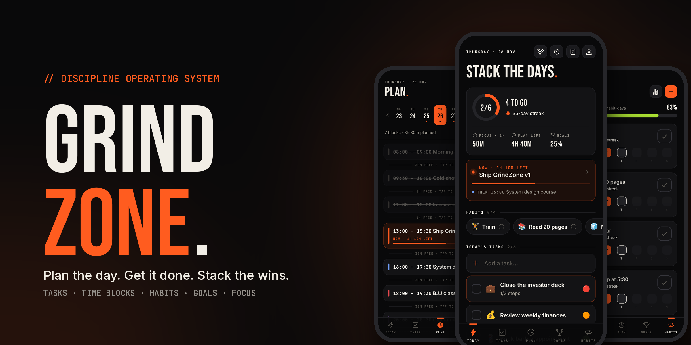
</p>

<h1 align="center">GrindZone</h1>

<p align="center">
  <b>A local-first productivity app for iPhone: tasks, time-blocked day planning, habits, goals and a Pomodoro focus timer in one app.</b><br />
  Built with Expo, React Native and TypeScript. Syncs through Supabase and keeps working offline.
</p>

<p align="center">
  
  
  
  
  
  
</p>

<p align="center">
  <a href="#screenshots">Screenshots</a> ·
  <a href="#features">Features</a> ·
  <a href="#architecture">Architecture</a> ·
  <a href="#engineering-highlights">Engineering</a> ·
  <a href="#try-it-on-your-iphone">Try it</a> ·
  <a href="#getting-started">Getting started</a>
</p>

---

## Overview

Most productivity apps split the day across separate tools: one for to-dos, one for the calendar, one for habits and another for a focus timer. GrindZone puts all of that on one screen and answers one question: **what do I do today?**

- **Today** shows your line for the day, today's progress and streak, an activity map of your history, what's on the schedule right now and today's tasks.
- Finishing a task, habit or focus session triggers **haptics, an animation and a new quote** (125+ curated, no repeats until all have been shown). Clearing the day brings up a full-screen **DAY WON**.
- **Local-first:** every action saves on the device straight away and works with no connection. When you sign in, data syncs to the cloud, so the same account loads the same data on any device.

## Screenshots

<table>
  <tr>
    <td align="center">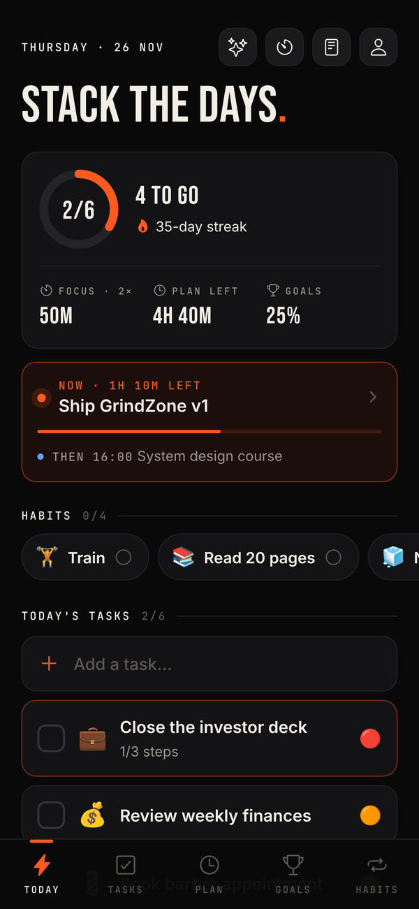<br /><sub><b>Today</b>: the day at a glance, habits, tasks</sub></td>
    <td align="center">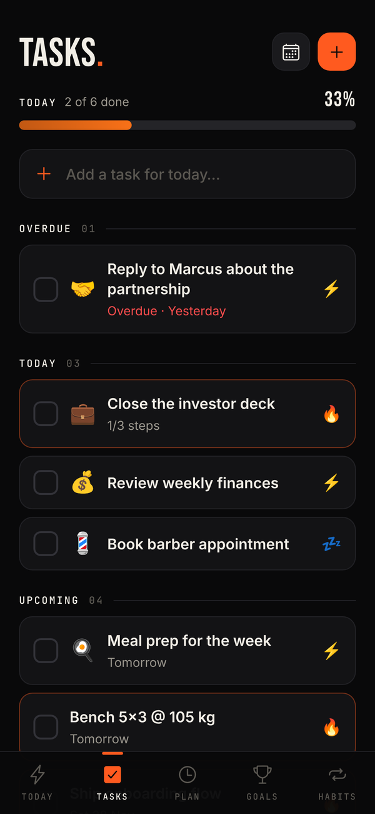<br /><sub><b>Tasks</b>: overdue, today, upcoming</sub></td>
    <td align="center">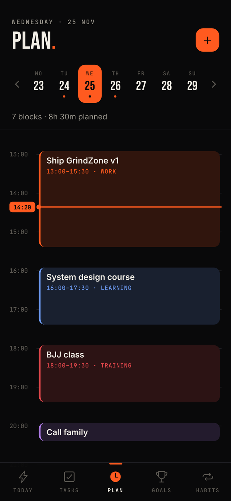<br /><sub><b>Plan</b>: your day as a written plan, or a timeline</sub></td>
    <td align="center">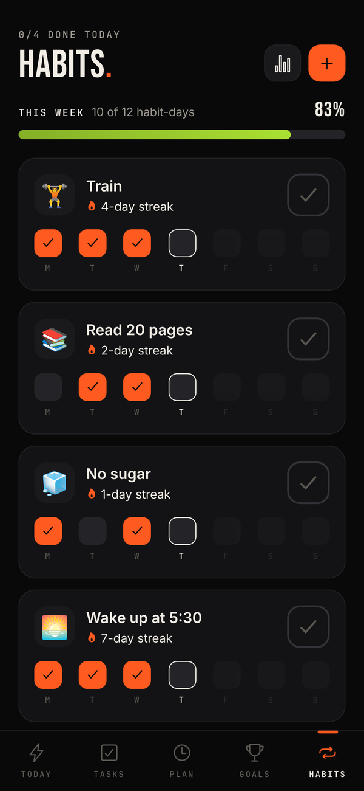<br /><sub><b>Habits</b>: one-tap check-in and streaks</sub></td>
  </tr>
  <tr>
    <td align="center">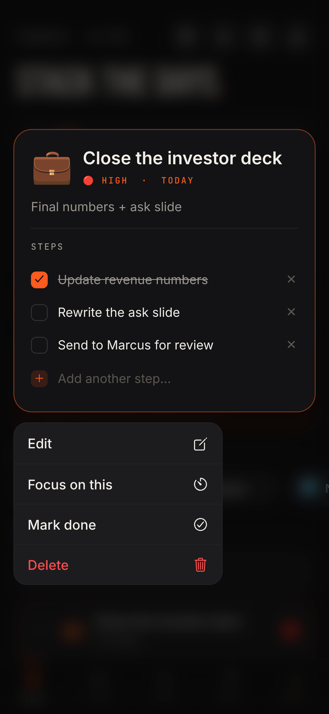<br /><sub><b>Hold</b>: drag to reorder, or let go for a preview</sub></td>
    <td align="center">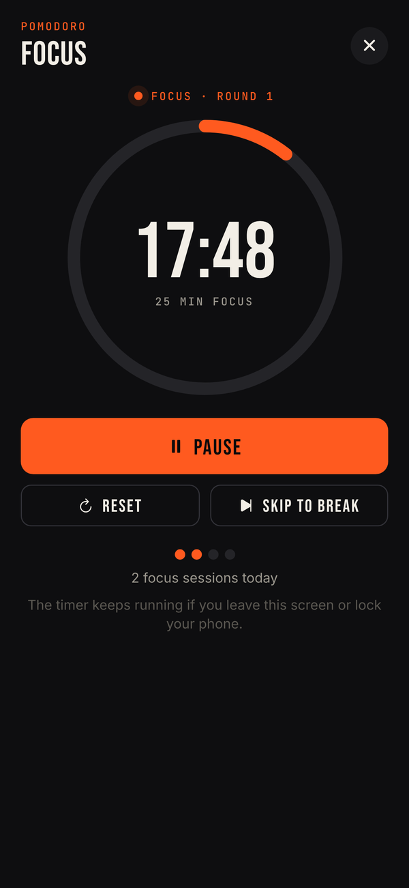<br /><sub><b>Focus</b>: Pomodoro that keeps running in the background</sub></td>
    <td align="center">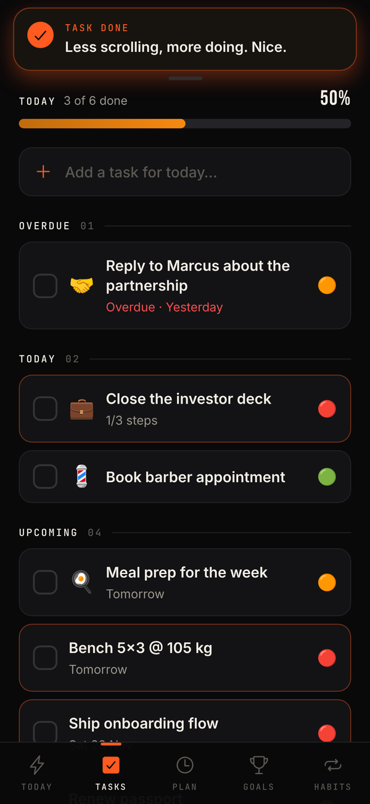<br /><sub><b>Rewards</b>: a new quote for every finished task</sub></td>
    <td align="center">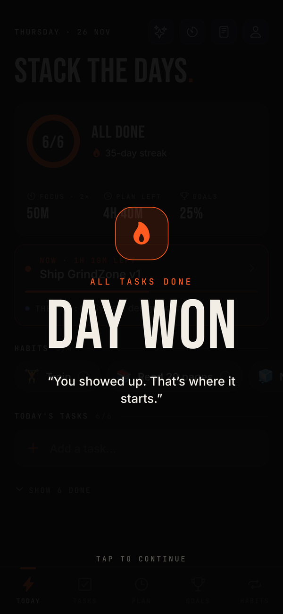<br /><sub><b>Day won</b>: every task done</sub></td>
  </tr>
  <tr>
    <td align="center">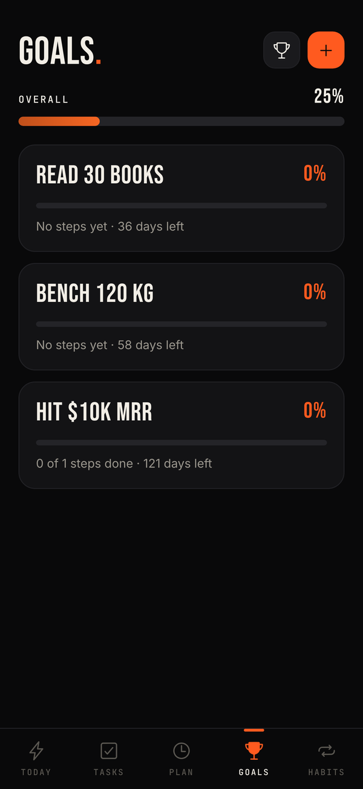<br /><sub><b>Goals</b>: overall progress in steps</sub></td>
    <td align="center">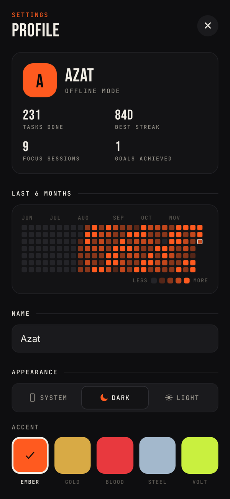<br /><sub><b>Profile</b>: stats, 6-month map, theming</sub></td>
    <td align="center">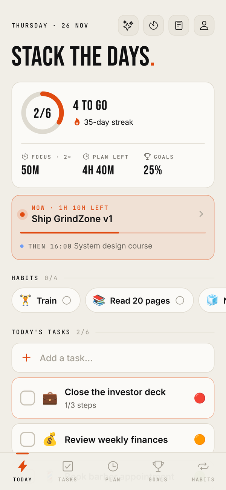<br /><sub><b>Light mode</b></sub></td>
    <td align="center">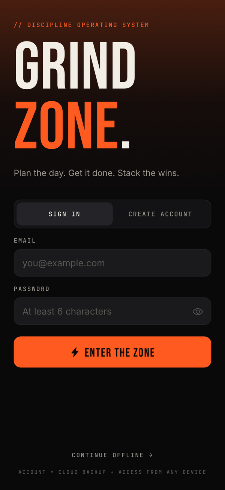<br /><sub><b>Sign in</b>, or continue offline</sub></td>
  </tr>
  <tr>
    <td align="center">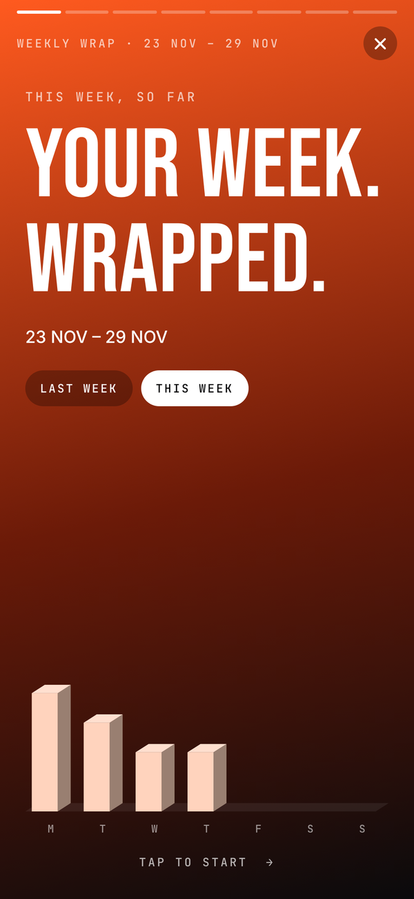<br /><sub><b>Weekly Wrap</b>: your week as a story</sub></td>
    <td align="center">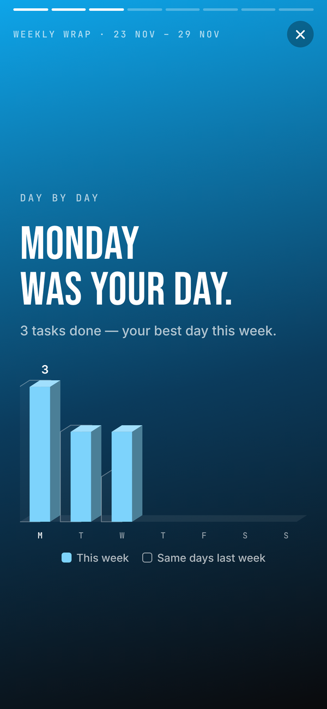<br /><sub><b>3D day-by-day</b> vs the week before</sub></td>
    <td align="center">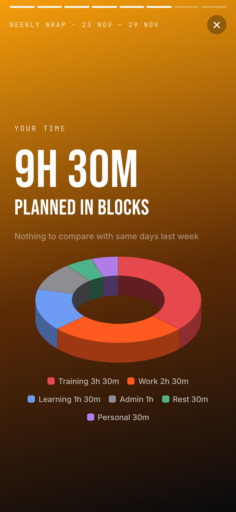<br /><sub><b>3D donut</b>: where your time went</sub></td>
    <td align="center">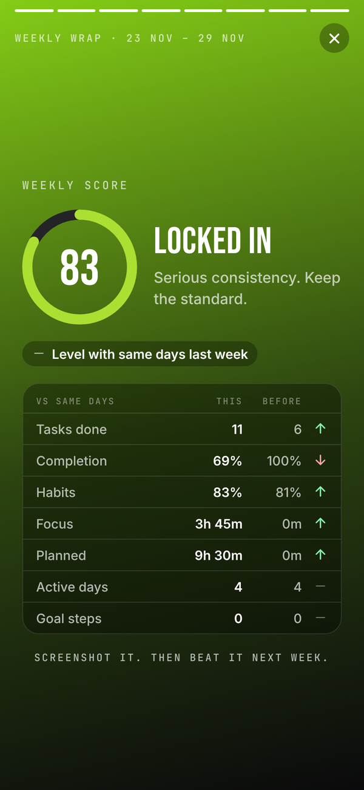<br /><sub><b>Weekly score</b> + week-over-week table</sub></td>
  </tr>
  <tr>
    <td align="center">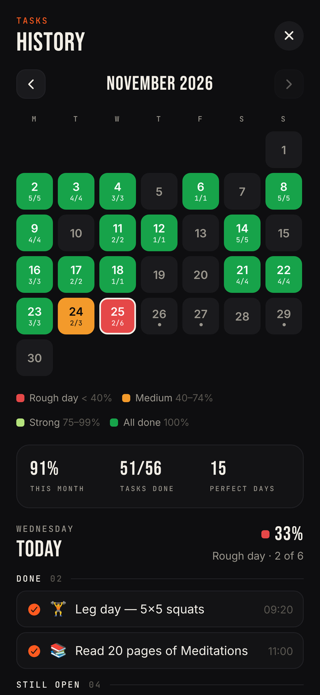<br /><sub><b>History</b>: every day coloured by how much got done</sub></td>
    <td align="center">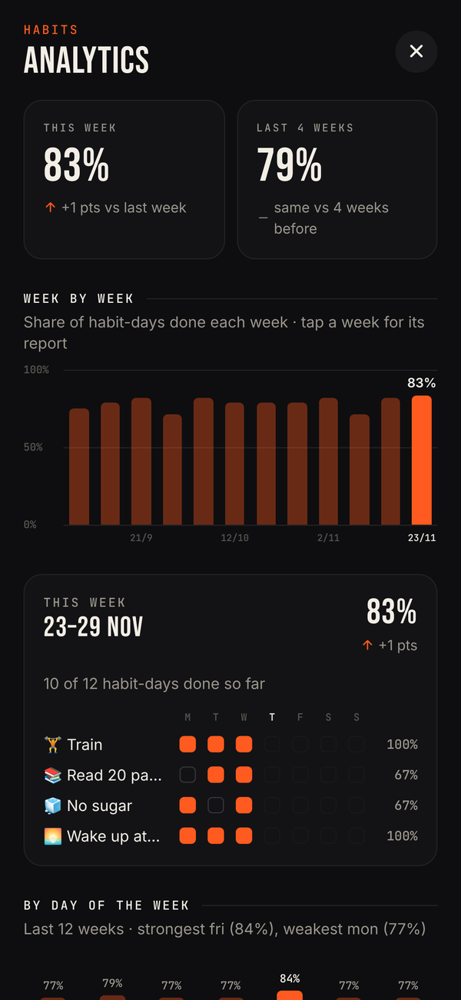<br /><sub><b>Habit analytics</b>: weekly trend and reports</sub></td>
    <td align="center">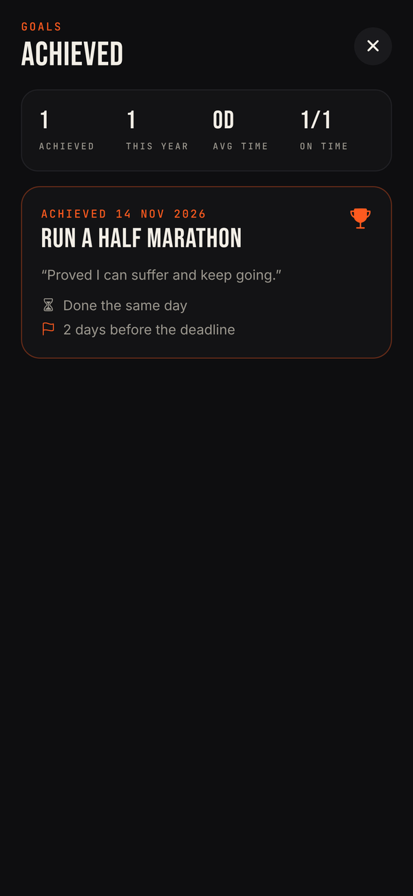<br /><sub><b>Achieved goals</b>: how long each one took</sub></td>
    <td align="center">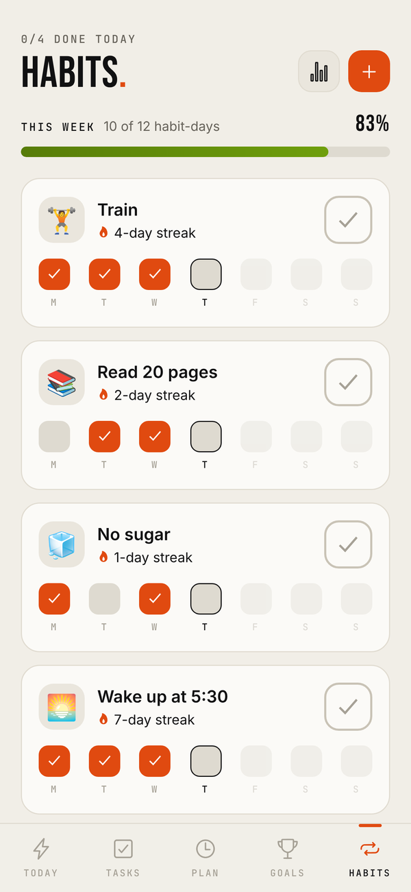<br /><sub><b>Habits</b>, light mode</sub></td>
  </tr>
</table>

## Features

| Area | What it does |
|---|---|
| **Today** | Your line for the day (tap to write your own and pick its size, or get a new one each day), one card with how the day is going (tasks ring, streak, focus time, plan time left, goals %), a "now / then" card from your plan with a live progress bar, **today's habits as chips you tick right there**, and today's tasks with quick add. |
| **Weekly Wrap** | Your week as a story, Spotify Wrapped style: tasks closed, your best day on a **3D bar chart**, habit consistency, deep-work sessions, where your planned time went on a **3D donut**, your "persona" (morning grinder, night owl…), streak, and a **weekly score** with a table comparing every stat to the week before (or the same days last week while the week is still going). |
| **Tasks** | One list grouped into Overdue, Today, Upcoming and Someday, with **today's productivity** as a bar in the header that turns from red through orange to green as you get closer to 100%. Each task can have an **emoji**, a **priority** shown as an emoji on the right (🔴 high · 🟠 medium · 🟢 low), a due date, notes and a **checklist of steps**. **Swipe left** on a task to delete it (a long swipe deletes straight away; a toast lets you undo). |
| **Task history** | A month calendar where every day is coloured by how much of that day's list got done (red → amber → light green → green) and shows done/total. Tap a day to see what you finished and what you missed. |
| **Press and hold** | Hold a task and the row lifts. **Drag** to put it anywhere in the list (dated tasks stay within their day), or **let go** for a preview: the screen blurs and the card opens in the middle of the screen, where you can tick off or add steps, start a focus session, mark it done or delete it. |
| **Plan** | Two views of the day. **List** (default) reads like a written plan — `10:30 – 12:30  Wake up, skincare, eat` on one line that shrinks to fit — with free time between blocks and a live "now" row; **double-tap a block to cross it off**. **Timeline** is a 24-hour grid with a "now" line. Type a block the way you'd write it (`14:00 - 15:30 Gym`) or **paste a whole day from your notes** into the same line: times are parsed in the order of your day (12-hour without am/pm works), the kind of block is guessed from the words, and a plan can run past midnight (until 06:00). Hold a block to edit, move it 30 minutes later, duplicate it to tomorrow or delete it; **copy yesterday's plan** for an empty day. |
| **Habits** | Daily habits with a one-tap check for today, the current week from Monday to Sunday (tap any past day to fix it), the current streak, and a **month calendar** per habit where you can tap any day to fix it. |
| **Habit analytics** | This week's and the last 4 weeks' consistency with the change vs the period before, a **12-week trend chart** (tap a week for its report: every habit × every day), your strongest and weakest day of the week, and a bar per habit with its trend. |
| **Goals** | A title, a "why", a deadline and its own **checklist of steps** (steps are not tasks). An overall progress bar counts progress in steps across all goals. Achieving a goal triggers a full-screen celebration, and the **trophy history** lists every achieved goal with how long it took and whether it beat the deadline. |
| **Focus** | Pomodoro with 15 / 25 / 45 / 60-minute sessions and 5 / 10 / 15-minute breaks, plus pause, reset and skip. The timer survives the app being backgrounded or the phone being locked, and **local notifications** fire when a session or break ends. It can be linked to a task. |
| **Notes** | A full-page notes list with pinning, autosave and search. |
| **Profile** | Lifetime stats (tasks done, best streak, focus sessions, goals achieved), a **GitHub-style 6-month activity map**, System / Dark / Light theme, 5 accent colours, a haptics toggle and account management. |

## Tech stack

| Layer | Choice | Why |
|---|---|---|
| App framework | **Expo SDK 58**, React Native 0.88, React 19 | Ships to iPhone through Expo Go and over-the-air updates, so there's no App Store round-trip |
| Language | **TypeScript** (`strict`) | Typed data model shared by the store, the sync engine and the UI |
| Navigation | **Expo Router** (file-based) | Tabs, modal sheets and an auth guard declared with `Stack.Protected` |
| State | **Zustand** + `persist` (AsyncStorage) | A small, fast store with versioned migrations for the on-device schema |
| Backend | **Supabase** (Postgres, Auth, Row Level Security) | Email/password auth and per-user data isolation enforced by the database |
| Motion | **Reanimated 4** (worklets), Gesture Handler, `expo-blur`, `react-native-svg` | Animations run on the UI thread: spring checkboxes, SVG progress rings, blurred previews |
| Native APIs | `expo-haptics`, `expo-notifications`, `expo-keep-awake`, `@react-native-community/datetimepicker` | Haptic feedback, timer alerts, screen kept on during focus, native time wheel |
| Delivery | **EAS Update** (OTA) + GitHub Actions | Publishes JS bundles to the cloud; a scheduled workflow keeps the backend warm |
| Typography | Bebas Neue, Inter, JetBrains Mono | Condensed display type, readable body text, monospaced labels |

## Architecture

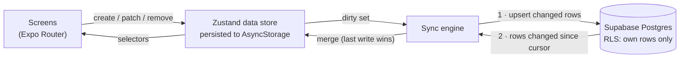

**Local-first data flow.** Screens never wait on the network. Every write goes to the local store, which updates the UI straight away, persists to AsyncStorage and marks the row as *dirty*. The sync engine runs in the background and is the only part of the app that talks to Supabase.

### Sync protocol

1. **Push:** dirty rows are upserted to Supabase in chunks of 500. A row is marked clean only if it hasn't been edited again while the request was in flight.
2. **Pull:** each table is read in pages of 1,000, ordered by `server_updated_at` and starting after the last saved cursor, so every sync fetches only what changed.
3. **Conflicts:** last write wins on the client's `updated_at`. This is enforced in two places: the client won't overwrite a newer local edit, and a Postgres trigger (`gz_touch`) **drops stale updates** coming from another device.
4. **Deletes** are soft (`deleted = true` tombstones), so a delete on one device reaches every other device.
5. **Cursor safety:** the trigger stamps `server_updated_at` with `clock_timestamp()` rather than `now()`, so rows written in the same transaction still get distinct, ordered cursor values and none are skipped.
6. **When it runs:** 1.2 s after a change (debounced), when the app returns to the foreground, and every 5 minutes. Only one sync runs at a time, and changes made during a sync trigger a follow-up run.

### Accounts and security

- Every table has **Row Level Security** with "own rows" policies (`(select auth.uid()) = user_id`), and `user_id` defaults to `auth.uid()`. The publishable key in the client can't read or write anyone else's data.
- **Guest mode:** the app works fully without an account. When a guest signs up, their local data is attached to the new account and uploaded. Signing in as a *different* user clears the local cache instead of mixing two people's data.

### Data model

| Table | Key columns |
|---|---|
| `tasks` | `title`, `notes`, `emoji`, `priority` (1–3), `due_date`, `subtasks` (jsonb), `done`, `done_at`, `sort_order` |
| `blocks` | `date`, `start_min`, `end_min` (minutes since midnight), `title`, `category`, `note` |
| `goals` | `title`, `why`, `target_date`, `status`, `achieved_at`, `steps` (jsonb checklist) |
| `habits` | `title`, `emoji`, `checks` (jsonb array of `YYYY-MM-DD` dates) |
| `notes` | `title`, `body`, `pinned` |

Every table also has `id` (client-generated UUID), `user_id`, `created_at`, `updated_at`, `deleted` and `server_updated_at`, plus a `(user_id, server_updated_at)` index for the pull query. The full schema is in [`supabase/migrations/`](supabase/migrations).

## Engineering highlights

- **Background-safe timer.** The focus timer stores an absolute `endsAt` timestamp instead of counting ticks, so it stays accurate after the app is suspended or the phone is locked. Local notifications for "focus done" and "break over" are scheduled when a session starts and cancelled when it's paused or reset.
- **Animations without dropped frames.** Checkbox pops, progress rings, the long-press preview and celebration overlays run on the UI thread with Reanimated 4. When you tick a task, the checkbox animates first and the store update follows about 380 ms later, so rows don't disappear mid-animation.
- **Gestures that don't fight each other.** Hold (drag or preview) and swipe (delete) are composed as competing gestures, so whichever starts first wins; a horizontal swipe fails as soon as the finger moves vertically, so scrolling stays smooth.
- **Drag to reorder without jank.** One long-press gesture (Gesture Handler 3 + Reanimated worklets on the UI thread) either opens the preview or starts a drag. Rows are positioned from a shared order and their measured heights, so the order shown while dragging is exactly the order that gets saved and rows never jump on drop. Moving a task usually writes a single row: it takes a `sort_order` between its new neighbours.
- **Derived state, not duplicated state.** Streaks, the activity heatmap, per-day task history, habit analytics (weekly rates, weekday breakdown, trends), goal progress and the "now / next" block are pure functions over the store, so nothing can drift out of sync.
- **A parser for plans written like notes.** `12:30 - 2:30 ERK` after `10:30 - 12:30 …` is read as 12:30–14:30, and `12:30 - 2:00 Sleep` at the end of the day as after midnight. Each time takes the earliest reading that keeps the day in order, `am`/`pm` and 24-hour times are respected, and blocks can run until 06:00 the next morning.
- **3D charts without a chart library.** The Weekly Wrap's isometric bars and tilted donut are drawn with `react-native-svg` from first principles: prism faces with shaded sides, and elliptical arcs with front and inner walls, all animated as each slide opens.
- **Charts that read clearly.** Single-series bar charts with thin rounded bars, recessive hairline grids and selective labels. The red → green productivity scale was checked with a colour-vision-deficiency validator, and every coloured day also shows done/total, so colour is never the only cue.
- **Keyboard-safe forms.** Every form scrolls with native keyboard insets (`automaticallyAdjustKeyboardInsets`), which measure the real on-screen position, so the field you're typing in stays visible even inside slide-up sheets.
- **Data migrations that sync.** When goal steps moved out of tasks into the goal itself, an idempotent migration (same ids) runs after every sync, so every device converges on the same result.
- **Versioned on-device schema.** The persisted store has a `version` and a `migrate` step, so updates never wipe data already on the device.
- **Over-the-air delivery.** `runtimeVersion` follows the SDK version, so every `eas update` reaches phones running Expo Go with no native build or App Store review.
- **Backend keep-alive.** A scheduled GitHub Action pings Supabase twice a week so the free-tier project is never paused.
- **Code quality.** TypeScript `strict`, ESLint (`eslint-config-expo`, including the React Hooks / React Compiler rules) and a `@/` path alias. Lint and typecheck pass cleanly.

## Try it on your iPhone

1. Install **Expo Go** from the App Store.
2. Scan this code with the iPhone camera and tap **Open in Expo Go**:

<p align="center"></p>

Or open this link on the phone: `exp://u.expo.dev/c65f044a-aba0-4cbd-9d20-df99fe481502?channel-name=main&runtime-version=exposdk:58.0.0`

The QR code always opens the latest published version (EAS Update, channel `main`). You can tap **Continue offline** to try the app without an account.

## Getting started

### Prerequisites

- Node.js 20+
- The **Expo Go** app on an iPhone (or an iOS Simulator)

### Run locally

```bash
git clone https://github.com/AzatKabulov/GrindZone.git
cd GrindZone
npm install
npx expo start          # scan the QR code with the iPhone camera
```

If the phone and computer aren't on the same network, use `npx expo start --tunnel`.

### Use your own Supabase project (optional)

Out of the box the app connects to the existing GrindZone backend. To run it against your own:

1. Create a Supabase project and run the SQL files in [`supabase/migrations/`](supabase/migrations) in order (in the SQL editor or with `supabase db push`).
2. Copy `.env.example` to `.env.local` and fill in your project URL and publishable key:
   ```bash
   EXPO_PUBLIC_SUPABASE_URL=https://<project-ref>.supabase.co
   EXPO_PUBLIC_SUPABASE_KEY=sb_publishable_...
   ```
3. Optional: under **Authentication → Sign In / Providers → Email**, turn off **Confirm email** so new accounts can sign in straight away.

### Scripts

| Command | Description |
|---|---|
| `npm start` | Start the Expo dev server |
| `npm run web` | Run the app in a browser |
| `npm run typecheck` | Type-check with `tsc --noEmit` |
| `npm run lint` | Lint with ESLint (`expo lint`) |
| `npm run publish` | Publish an over-the-air update to the `main` channel (EAS Update) |

## Project structure

```
src/
├── app/                  # Routes (Expo Router): every file is a screen
│   ├── (tabs)/           # Today, Tasks, Plan, Goals, Habits
│   ├── task/[id].tsx     # Task editor (modal sheet)
│   ├── block/[id].tsx    # Time block editor
│   ├── goal/[id].tsx     # Goal editor
│   ├── habit/[id].tsx    # Habit history and editor
│   ├── note/[id].tsx     # Note editor
│   ├── focus.tsx         # Pomodoro timer
│   ├── wrap.tsx          # Weekly Wrap (story slides)
│   ├── history.tsx       # Task history calendar (shared MonthCalendar)
│   ├── habits-stats.tsx  # Habit analytics
│   ├── goals-history.tsx # Achieved goals
│   ├── notes.tsx         # Notes list
│   ├── settings.tsx      # Profile, stats, theme, account
│   ├── sign-in.tsx       # Auth
│   └── _layout.tsx       # Fonts, auth guard, global hosts (rewards, preview, focus engine)
├── components/           # UI kit, TaskRow, ReorderableTasks, Heatmap, ProgressRing, TaskPeek, pickers…
├── store/
│   ├── data.ts           # Persisted local database (tables, dirty set, cursors, migrations)
│   ├── sync.ts           # Push/pull sync engine
│   ├── selectors.ts      # Streaks, activity, progress, schedule (pure functions)
│   ├── actions.ts        # Domain actions + reward triggers
│   ├── focus.ts          # Pomodoro state machine
│   ├── habitStats.ts     # Habit analytics (weekly rates, weekday breakdown, trends)
│   ├── wrap.ts           # Weekly Wrap numbers, score and week-over-week comparison
│   └── auth.ts, settings.ts, fx.ts, peek.ts, drag.ts
├── lib/                  # Dates, plan parser, quotes, categories, colours, haptics, notifications, Supabase client
└── theme/                # Colour tokens (dark/light), accents, typography
supabase/migrations/      # Postgres schema, RLS policies, sync trigger
.github/workflows/        # Supabase keep-alive
```

## Roadmap

- [ ] Home Screen and Lock Screen widgets (today's progress, current block)
- [ ] Live Activity for the focus timer
- [ ] Sync focus history and custom mantras across devices
- [ ] Recurring tasks and time blocks
- [ ] Weekly review screen with trends
- [ ] App Store release through EAS Build and Submit

## Author

**Azat Kabulov**: [GitHub @AzatKabulov](https://github.com/AzatKabulov)

If you have feedback or ideas, feel free to open an issue.
